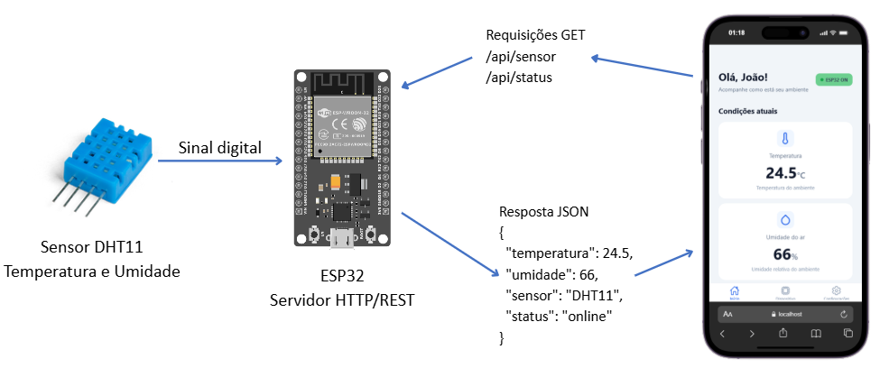

# Meu Ambiente

Aplicativo mobile desenvolvido para monitoramento de temperatura e umidade do ambiente, utilizando React Native e ESP32.


## Funcionalidades

- Tela de identificação do usuário.
- Monitoramento de temperatura e umidade.
- Atualização automática dos dados a cada 2 segundos.
- Cálculo da média das últimas 10 leituras.
- Monitoramento do status de conexão com o ESP32.
- Visualização das informações do dispositivo.
- Modo claro e escuro.


## Arquitetura



## Endpoints da API

| Método | Endpoint | Descrição |
|---|---|---|
| GET | /api/sensor | Retorna temperatura, umidade e status do sensor. |
| GET | /api/status | Retorna informações do ESP32 e da conexão Wi-Fi. |

## Estrutura do projeto

- `src/app/`: telas e configuração da navegação.
- `src/components/`: componentes reutilizáveis.
- `src/contexts/`: gerenciamento de estados compartilhados.
- `src/styles/`: estilos das telas e componentes.
- `assets/`: imagens e recursos visuais.

## Instalação e execução

### Pré-requisitos

- Node.js
- npm
- Expo
- ESP32 com o firmware configurado.
- Aplicativo e ESP32 conectados à mesma rede Wi-Fi.

### Instalar as dependências

```bash
npm install
```

### Executar o aplicativo

```bash
npx expo start
```

### Configuração da comunicação

Configure o endereço IP do ESP32 nos arquivos `home.tsx` e `dispositivo.tsx`, conforme o endereço atribuído ao dispositivo na rede local.